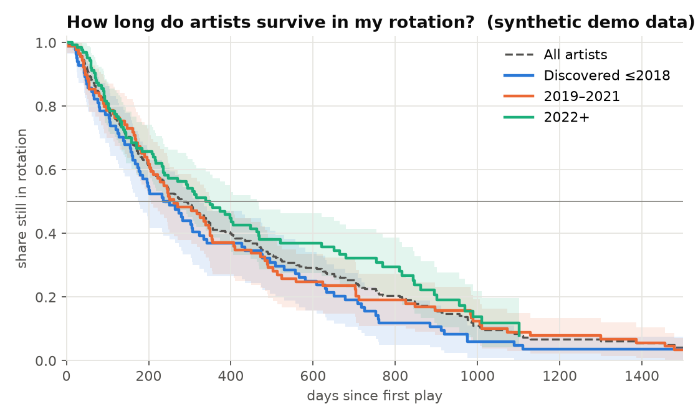
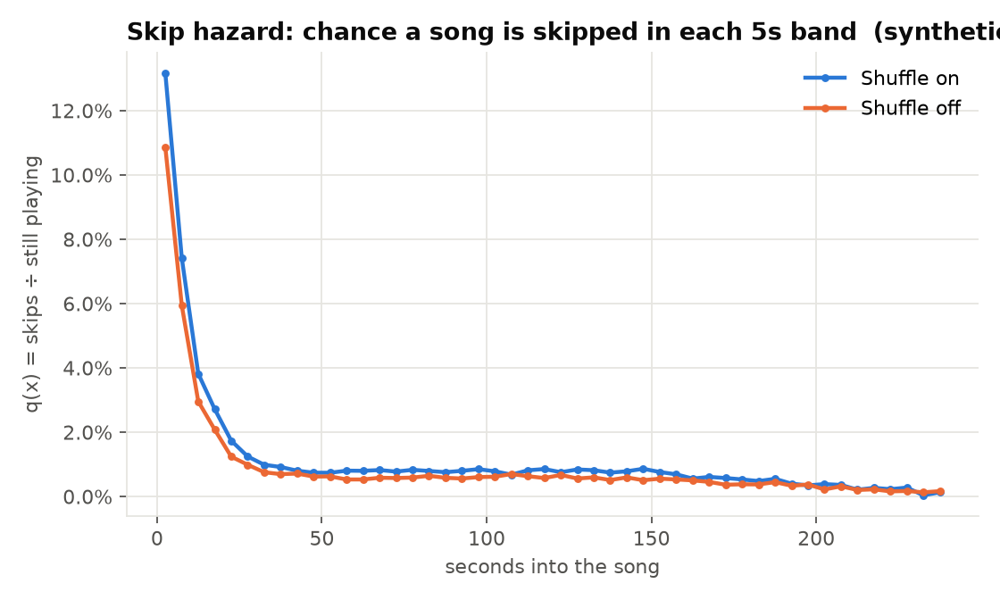
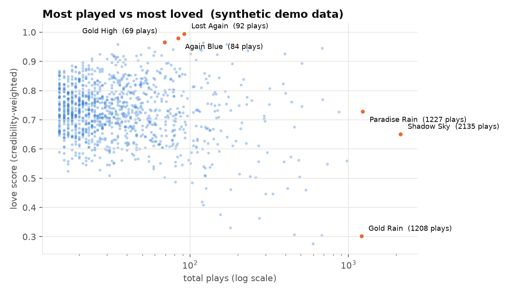
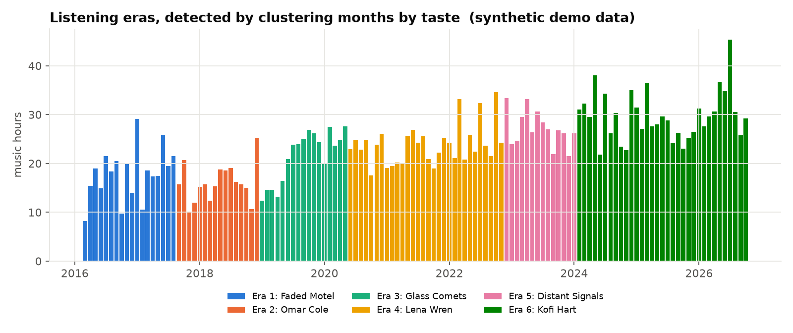
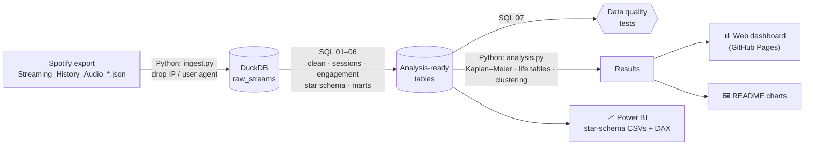

# Listening Survival 🎧📉

**Ten years of Spotify streaming history, analysed with SQL, Python, Power BI and the actuarial toolkit.**

Spotify Wrapped tells you what you played most. This project asks better questions:

- **How long does an artist survive in my rotation?** (Kaplan–Meier survival curves, by discovery cohort)
- **When do I skip a song?** (a life table for songs, where a skip counts as a death)
- **What do I actually *love*, versus what I just hear a lot?** (an engagement score with Bühlmann credibility weighting)
- **What were my musical "eras"?** (months clustered by taste, with a constraint that keeps each era continuous)
- **Which podcasts stick, and which do I abandon?**

[](../../actions/workflows/ci.yml)
&nbsp;**[▶ Live interactive dashboard](https://YOUR-GITHUB-USERNAME.github.io/spotify-listening-survival/)**

> **Status:** the pipeline, analysis and dashboard are complete and running on a **synthetic dataset** that mirrors Spotify's export format field for field (see [why](#why-synthetic-data)). My real 10-year export has been requested, and the findings below will be regenerated from it when it arrives.

---

## Key findings (demo data)

| | |
|---|---|
|  |  |
|  |  |

- **Half of the artists that enter my rotation are gone within ~9½ months.** Only ~41% last a full year.
- **Songs are most "at risk" in the first 5 seconds.** About a quarter of plays are skipped within 30s, and the hazard drops sharply after the first minute. Shuffle raises early-skip risk.
- **Most played ≠ most loved.** My #3 most-played track is skipped 90% of the time, so it's a habit (autoplay or playlist inertia), not a favourite. My most-loved track by engagement ranks only #134 on raw plays.
- **Burnout vs evergreen.** One artist got 1,000+ plays in 130 days and then disappeared. Another has been in rotation for 10+ years.

👉 Full auto-generated list: [`outputs/insights.md`](outputs/insights.md)

---

## How it works



| Layer | Tool | What it does |
|---|---|---|
| Extract & load | **Python** ([`src/ingest.py`](src/ingest.py)) | Reads the JSON files, removes personal identifiers, converts UTC to local time, loads into DuckDB |
| Transform | **SQL / DuckDB** ([`sql/`](sql)) | Cleaning, sessionisation (gaps-and-islands), engagement scoring, star schema, analysis marts |
| Test | **SQL** ([`sql/07_checks.sql`](sql/07_checks.sql)) | Row counts reconcile, no listening time lost, keys unique, scores in range. The pipeline stops if any test fails |
| Analyse | **Python** ([`src/analysis.py`](src/analysis.py)) | Hand-written Kaplan–Meier with Greenwood CIs, actuarial life table, constrained hierarchical clustering |
| Visualise | **Power BI** ([`docs/powerbi_guide.md`](docs/powerbi_guide.md)), **HTML/Chart.js** ([`dashboard/`](dashboard)), **matplotlib** | Star-schema model with DAX measures, an interactive web dashboard, static charts |
| Automate | **GitHub Actions** | Every push regenerates synthetic data and runs the full pipeline and tests; the dashboard deploys to Pages |

A plain-English walkthrough of the design decisions is in **[`docs/ARCHITECTURE.md`](docs/ARCHITECTURE.md)**.

---

## Methods

### 1. Engagement score: plays aren't all equal
A song that auto-played for 4 seconds before being skipped shouldn't count the same as one you searched for and replayed. Each play is scored ([`sql/04_engagement.sql`](sql/04_engagement.sql)):

```
engagement = 0                                   if played < 30s  (Spotify's own threshold)
           = completion × intent_multiplier      otherwise

intent_multiplier = 1.50  deliberate replay (pressed back to hear it again)
                    1.25  chosen (clicked in a list or search)
                    1.00  passive (autoplay / shuffle / next track)
```
Spotify doesn't provide track length, so it's estimated from plays that ended with `reason_end = 'trackdone'` ([`sql/02_track_lengths.sql`](sql/02_track_lengths.sql)).

### 2. Love score: credibility weighting
Ranking by *average* engagement lets a track played twice beat one played 300 times. So the average is blended with the overall average using **Bühlmann credibility**, the same idea actuaries use to weight a small portfolio's own experience:

```
Z = n / (n + 20)      love_score = Z × track_avg + (1 − Z) × overall_avg
```

### 3. Survival analysis
- **Artist lifetimes:** an artist is "born" at their first counted play and "dies" after 90 days without a play. Artists still playing at the end of the data are **right-censored**. Kaplan–Meier is implemented directly in numpy (~15 lines) so the method is visible, with Greenwood 95% intervals. Curves are split by discovery cohort to test "is my taste getting more fickle?"
- **Skip life table:** each play is a life and a skip is a death. Plays that finish or stop for other reasons (app closed, etc.) are censored. `q(x)` is the probability of a skip in each 5-second band, given the song survived that far, exactly like `q_x` in a mortality table.

### 4. Listening eras
Each month becomes a vector of listening share per artist. **Agglomerative clustering with a connectivity constraint** (a month can only merge with its neighbours) repeatedly joins the most similar adjacent stretches, which guarantees continuous eras. The number of eras is chosen by silhouette score.

---

## Run it on your own Spotify data

```bash
git clone https://github.com/YOUR-GITHUB-USERNAME/spotify-listening-survival
cd spotify-listening-survival
make all          # set up, generate demo data, run the pipeline
make serve        # open http://localhost:8000
```
To use **your own** data: request *Extended streaming history* from [Spotify's privacy page](https://www.spotify.com/account/privacy/), unzip it into `data/raw/`, and run `make run`.

## Repository layout
```
sql/            01–06 transformation models, 07 data quality tests   ← the core logic
src/            ingest, pipeline orchestrator, analysis, publishing, synthetic generator
dashboard/      static interactive dashboard (index.html + generated data.js)
outputs/        charts and auto-generated insights
docs/           architecture walkthrough, Power BI build guide
data/raw/       your export goes here (git-ignored)
```

## Why synthetic data?
1. Spotify's extended export takes up to 30 days, so the generator meant the pipeline could be built and tested in the meantime.
2. Anyone can clone and run this project without needing a Spotify export.
3. **Known patterns are planted** (eras, a burnout artist, an evergreen artist, an abandoned podcast), which checks that the analysis recovers them. That's a test of the method, not just the code.

## Privacy
IP addresses, user agents and usernames are dropped at ingest. Raw exports, the DuckDB database and play-level CSVs are git-ignored. Only aggregates are published.

## Limitations & next steps
- Spotify's export has no genre or audio features, so eras are defined by artists, not genres.
- Engagement weights are judgement calls, kept in one SQL file so they're easy to challenge.
- **Next:** a competing-risks view of skips (skip vs stop vs finish), recommendations from listening co-occurrence, and a drag-and-drop web version so anyone can analyse their own export in the browser.

---
*Built by Yusuf Ali.*
